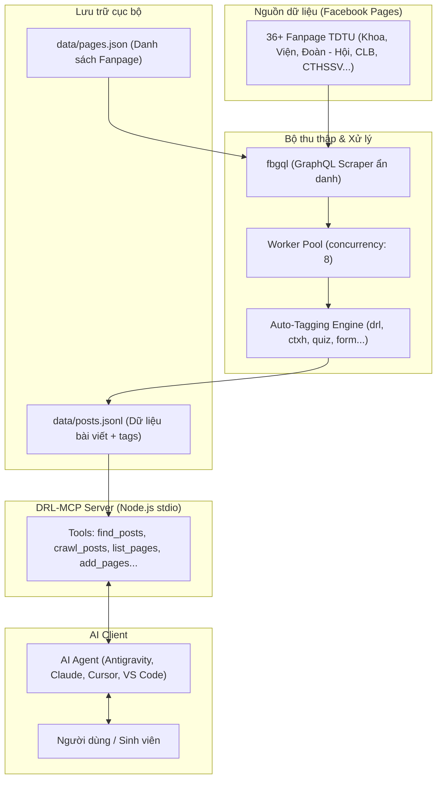
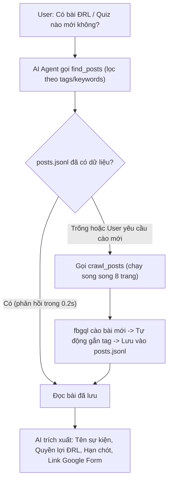

# DRL-MCP (Điểm Rèn Luyện MCP)

MCP server (stdio) hỗ trợ AI Agent tìm kiếm, theo dõi và lọc bài viết từ các Facebook Pages theo từ khóa, phục vụ việc tổng hợp thông tin về **Điểm rèn luyện (ĐRL)** và hoạt động sinh viên từ nhiều nguồn (hiện tại hỗ trợ sẵn 36 pages của Trường Đại học Tôn Đức Thắng - TDTU).

## Tính năng

- **Tra cứu bài viết**: `find_posts` — tìm kiếm bài đã lưu theo từ khóa (`keywords`), tags danh mục (`drl`, `ctxh`, `quiz`, `form`, `workshop`, `contest`) và khoảng thời gian (`after`, `before`).
- **Cào dữ liệu đa luồng**: `crawl_posts` — cào bài viết mới từ tất cả các page theo dõi qua GraphQL (ẩn danh, không cần tài khoản cá nhân, mặc định cào song song 8 trang).
- **Tự động gắn nhãn (Auto-Tagging)**: phân loại bài viết ngay khi cào (`drl` cho Điểm rèn luyện, `ctxh` cho Công tác xã hội, `quiz` cho bài làm trắc nghiệm Google Form, `form` cho đơn đăng ký, `workshop`, `contest`).
- **Quản lý nguồn theo dõi**: `list_pages`, `add_pages`, `remove_pages` — xem, thêm hoặc xóa Fanpage cần giám sát (`data/pages.json`).
- **Bảo trì dữ liệu**: `clean_posts` — xóa bài viết cũ trước mốc ngày chỉ định để tối ưu dung lượng.
- **AI Skill đi kèm**: `.agents/skills/fb-page-monitor` — hướng dẫn AI trích xuất thông tin chuẩn hóa: Tên hoạt động, Quyền lợi ĐRL/CTXH, Điều kiện ghi nhận, Hạn chót và Link form đăng ký.

## Kiến trúc & Luồng hoạt động

### Kiến trúc hệ thống



### Luồng thực thi (Cache-first)



## Yêu cầu

- **Node.js** >= 22.6 (chạy trực tiếp TypeScript bằng `--experimental-strip-types`, không cần build).
- **Python** 3.x có cài thư viện `fbgql` (`pip install fbgql`).

## Cài đặt

```bash
git clone https://github.com/MinhKhoa05/DRL-MCP.git
cd DRL-MCP
npm install
pip install fbgql
```

## Cấu hình

Server đọc các biến môi trường tùy chọn:

| Biến | Mặc định | Mô tả |
| --- | --- | --- |
| `CRAWL_CONCURRENCY` | `8` | Số lượng trang cào đồng thời |
| `POSTS_FILE` | `./data/posts.jsonl` | Đường dẫn file lưu trữ bài viết |
| `PAGES_FILE` | `./data/pages.json` | Đường dẫn file danh sách trang |
| `PYTHON_PATH` | `py` (Windows) / `python3` (Unix) | Đường dẫn đến file thực thi Python |

## Chạy thử

```bash
node --experimental-strip-types src/server.ts
```

Log sẽ in ra stderr; MCP giao tiếp JSON-RPC qua stdio (stdout/stdin).

## Kết nối với AI client

Tất cả client đều cấu hình chạy: `node --experimental-strip-types src/server.ts` tại thư mục của dự án. Thay `/ABS/PATH/TO/DRL-MCP` bằng đường dẫn tuyệt đối đến thư mục project.

### Antigravity / Claude Desktop / Cursor
Thêm vào file cấu hình MCP:

```json
{
  "mcpServers": {
    "drl-mcp": {
      "command": "node",
      "args": ["--experimental-strip-types", "src/server.ts"],
      "cwd": "/ABS/PATH/TO/DRL-MCP"
    }
  }
}
```

### VS Code
Thêm vào `.vscode/mcp.json`:

```json
{
  "servers": {
    "drl-mcp": {
      "type": "stdio",
      "command": "node",
      "args": ["--experimental-strip-types", "src/server.ts"],
      "cwd": "/ABS/PATH/TO/DRL-MCP"
    }
  }
}
```

> **Lưu ý:** Sau khi lưu file cấu hình, hãy khởi động lại (Reload / Restart) AI Client để nhận danh sách tool.

## Cách dùng nhanh

Một số prompt gợi ý khi dùng với AI:

- "Tìm các bài viết có cộng điểm rèn luyện (ĐRL) mới nhất từ ngày 15/11 đến nay."
- "Có hoạt động nào làm form trắc nghiệm online (quiz) để cộng điểm không?"
- "Tổng hợp các hoạt động tình nguyện tính ngày CTXH còn hạn đăng ký."
- "Có workshop hay hội thảo nào sắp diễn ra cuối tuần này không?"
- "Cào cập nhật bài viết mới từ tất cả các trang theo dõi."
- "Thêm trang https://www.facebook.com/it.tdtu vào danh sách theo dõi."

## Danh sách tool

| Tool | Tham số | Mô tả |
| --- | --- | --- |
| `find_posts` | `keywords?`, `tags?`, `after?`, `before?` | Tìm và lọc bài viết đã lưu theo từ khóa, ngày hoặc tags (`drl`, `ctxh`, `quiz`, `form`, `workshop`, `contest`) |
| `crawl_posts` | `after?`, `before?`, `concurrency?` | Cào bài viết mới từ Facebook (mặc định lấy 15 ngày gần nhất, chạy song song 8 luồng) |
| `list_pages` | — | Xem danh sách tất cả các trang Facebook đang theo dõi kèm thời điểm cào gần nhất |
| `add_pages` | `pages: [{ url, name }]` | Thêm một hoặc nhiều trang mới vào danh sách theo dõi |
| `remove_pages` | `targets: [url_hoặc_tên]` | Xóa một hoặc nhiều trang khỏi danh sách theo dõi |
| `clean_posts` | `before` | Xóa các bài viết cũ trước mốc ngày chỉ định (YYYY-MM-DD) |

## Cấu trúc dự án

```text
DRL-MCP/
├── .agents/
│   └── skills/
│       └── fb-page-monitor/       # Skill AI: tự động trích xuất ĐRL, deadline, form URL
│           ├── references/        # Bảng tra cứu từ khóa & tiêu chuẩn trích xuất
│           └── SKILL.md           # Quy trình xử lý của AI Agent
├── data/
│   ├── pages.json                 # Danh sách 36 Fanpage TDTU theo dõi mặc định
│   └── posts.jsonl                # File lưu bài viết JSON Lines (kèm tags)
├── src/
│   ├── pages.ts                   # Thao tác đọc/ghi danh sách trang
│   ├── posts.ts                   # Cào fbgql đa luồng, auto-tagging, tìm kiếm
│   └── server.ts                  # Entry point MCP server (stdio)
├── package.json
├── tsconfig.json
└── README.md
```

## Giấy phép

MIT
