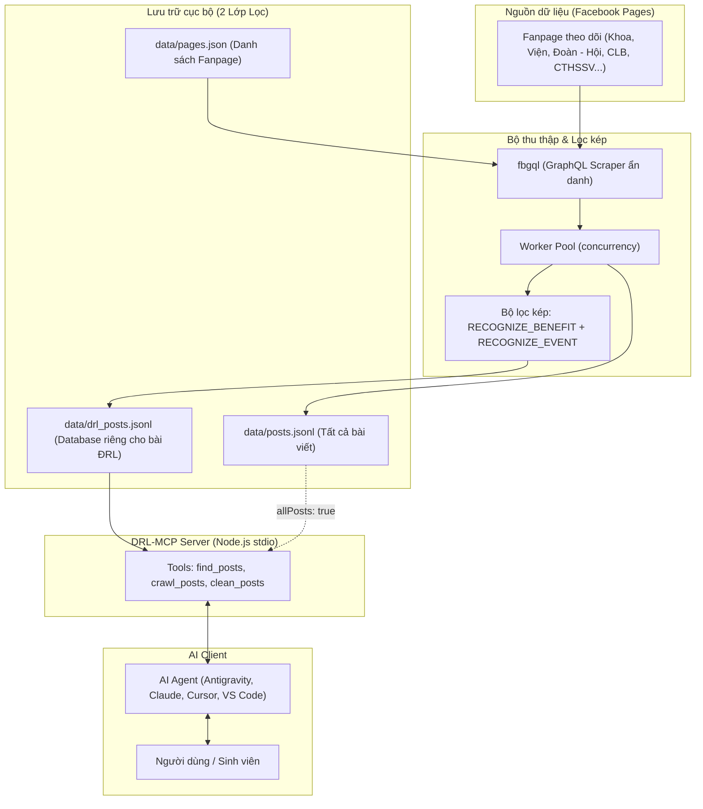

# DRL-MCP (Facebook ĐRL Tracker MCP)

MCP Server (stdio) hỗ trợ AI Agent theo dõi, cào bài viết và lọc tự động các hoạt động cộng **Điểm Rèn Luyện (ĐRL)** từ các Fanpage Facebook theo dõi. Hệ thống sử dụng kiến trúc lọc 2 lớp giúp phân tách sạch sẽ bài viết rèn luyện khỏi các bài truyền thông chung.

---

## Tính năng chính

- **Cào bài viết (Crawl posts)**: Tự động cào bài viết mới từ tất cả các Fanpage Facebook đang theo dõi (ẩn danh, đa luồng, không cần tài khoản cá nhân).
- **Tìm kiếm & Tra cứu bài viết**: Lọc nhanh các bài viết có cộng Điểm Rèn Luyện (ĐRL), hoạt động trực tuyến, workshop, tình nguyện... theo từ khóa và mốc thời gian.
- **Sẵn sàng nguồn dữ liệu phong phú**: Tích hợp sẵn danh sách **38 Fanpage trọng điểm của TDTU** (Khoa, Viện, Đoàn - Hội, CLB, CTHSSV...) thường xuyên có hoạt động ĐRL; bạn có thể dễ dàng bổ sung hoặc tùy chỉnh trực tiếp qua file `data/pages.json`.
- **Dọn dẹp dữ liệu**: Hỗ trợ dọn dẹp các bài viết cũ để giải phóng bộ nhớ lưu trữ.

---

## Kiến trúc & Luồng hoạt động



---

## Yêu cầu môi trường

- **Node.js** >= 22.6 (chạy trực tiếp TypeScript bằng `--experimental-strip-types`, không cần bước build).
- **Python** 3.x có cài thư viện `fbgql` (`pip install fbgql`).

---

## Cài đặt

```bash
git clone https://github.com/MinhKhoa05/DRL-MCP.git
cd DRL-MCP
npm install
pip install fbgql
```

---

## Cấu hình biến môi trường (Tùy chọn)

| Biến | Mặc định | Mô tả |
| :--- | :--- | :--- |
| `CRAWL_CONCURRENCY` | `8` | Số lượng trang cào đồng thời |
| `POSTS_FILE` | `./data/posts.jsonl` | Đường dẫn file lưu trữ toàn bộ bài viết |
| `DRL_POSTS_FILE` | `./data/drl_posts.jsonl` | Đường dẫn file lưu trữ riêng bài viết ĐRL |
| `PAGES_FILE` | `./data/pages.json` | Đường dẫn file danh sách trang theo dõi |
| `PYTHON_PATH` | `py` (Windows) / `python3` (Unix) | Đường dẫn đến file thực thi Python |

---

## Chạy thử Server

```bash
node --experimental-strip-types src/server.ts
```

Server giao tiếp JSON-RPC qua stdio (stdout/stdin), log sẽ in ra stderr.

---

## Kết nối với AI Client

### Antigravity / Claude Desktop / Cursor
Thêm vào file cấu hình MCP (`mcp.json` hoặc `claude_desktop_config.json`):

```json
{
  "mcpServers": {
    "fb-drl-tracker": {
      "command": "node",
      "args": ["--experimental-strip-types", "src/server.ts"],
      "cwd": "/ĐƯỜNG_DẪN_TUYỆT_ĐỐI_TỚI/DRL-MCP"
    }
  }
}
```

### VS Code
Thêm vào `.vscode/mcp.json`:

```json
{
  "servers": {
    "fb-drl-tracker": {
      "type": "stdio",
      "command": "node",
      "args": ["--experimental-strip-types", "src/server.ts"],
      "cwd": "/ĐƯỜNG_DẪN_TUYỆT_ĐỐI_TỚI/DRL-MCP"
    }
  }
}
```

---

## Hướng dẫn sử dụng nhanh với AI

Bạn có thể tương tác tự nhiên với AI Agent bằng các câu hỏi thông dụng:

- **Tra cứu bài viết ĐRL mới nhất:**
  > *"Tìm tất cả các bài có điểm rèn luyện từ ngày 15/11 đến nay và báo cáo cho tôi."*
- **Tìm bài làm form trực tuyến / trắc nghiệm:**
  > *"Có hoạt động trực tuyến hoặc bài trắc nghiệm Google Form nào lấy ĐRL còn hạn không?"*
- **Tìm theo chủ đề chuyên biệt (Workshop, Tình nguyện, Học thuật):**
  > *"Tổng hợp các workshop hoặc cuộc thi học thuật có cộng ĐRL sắp diễn ra."*
  > *"Có hoạt động tình nguyện hay dọn vệ sinh nào tính ngày CTXH cuối tuần này không?"*
- **Cập nhật dữ liệu từ Facebook:**
  > *"Cào cập nhật các bài viết mới nhất từ tất cả các trang theo dõi."*
- **Quản lý danh sách Fanpage:**
  > *"Xem danh sách các Fanpage đang theo dõi."*
  > *"Thêm trang `https://www.facebook.com/it.tdtu` vào danh sách theo dõi giúp tôi."*
- **Dọn dẹp bài viết cũ:**
  > *"Xóa giúp tôi các bài viết cũ trước ngày 01/10/2026."*

---

## Danh sách công cụ (Tools)

Server tập trung vào 3 công cụ xử lý logic nặng và tự động:

| Tool | Tham số | Mô tả |
| :--- | :--- | :--- |
| `find_posts` | `keywords?`, `after?`, `before?`, `allPosts?` | Tìm kiếm bài viết theo từ khóa và ngày. Mặc định tra cứu trong `drl_posts.jsonl`. Đặt `allPosts: true` nếu muốn quét toàn bộ bài gốc. |
| `crawl_posts` | `after?`, `before?` | Cào bài viết mới từ tất cả các trang theo dõi, tự động lọc bài ĐRL vào database riêng. Mặc định lấy 15 ngày gần nhất. |
| `clean_posts` | `before` | Xóa các bài viết cũ trước mốc ngày chỉ định (YYYY-MM-DD) trên cả 2 file database để giải phóng dung lượng. |

> **Quản lý Fanpage (`pages.json`):** Agent có thể trực tiếp đọc và chỉnh sửa file `data/pages.json` bằng công cụ file có sẵn, giúp tiết kiệm token ngữ cảnh của MCP schema.

---

## Cấu trúc dự án

```text
DRL-MCP/
├── .agents/
│   └── skills/
│       └── fb-drl-tracker/        # AI Skill: Bảng từ khóa, chiến lược truy vấn & trích xuất
│           └── SKILL.md           # Hướng dẫn chi tiết cho AI Agent
├── data/
│   ├── pages.json                 # Danh sách các Fanpage theo dõi
│   ├── posts.jsonl                # Toàn bộ bài viết đã cào được
│   └── drl_posts.jsonl            # Các bài viết liên quan điểm rèn luyện đã được lọc thô bằng regex keyword
├── src/
│   ├── pages.ts                   # Đọc/ghi cấu hình danh sách trang
│   ├── posts.ts                   # Cào fbgql đa luồng, bộ lọc kép ĐRL, tìm kiếm regex
│   └── server.ts                  # Entry point MCP server (stdio)
├── package.json
├── tsconfig.json
└── README.md
```

---

## Giấy phép

MIT
